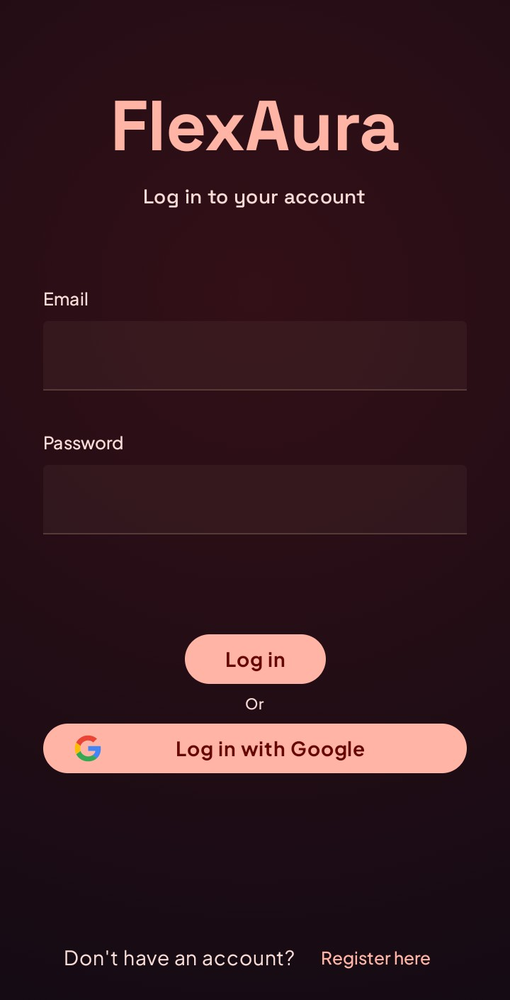
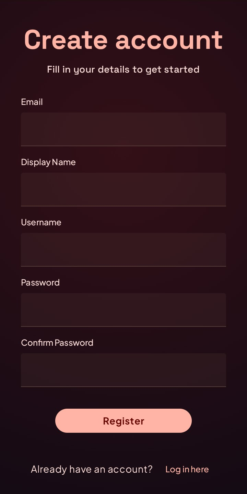
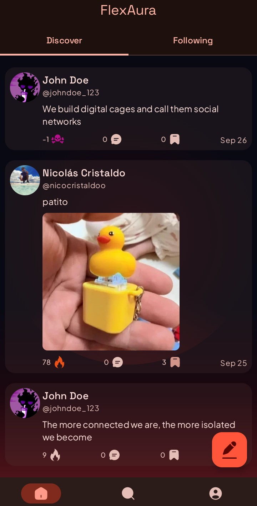
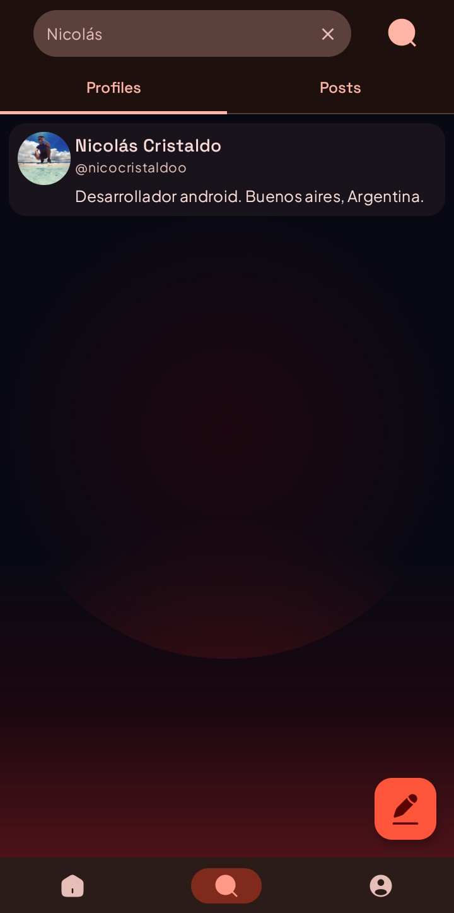
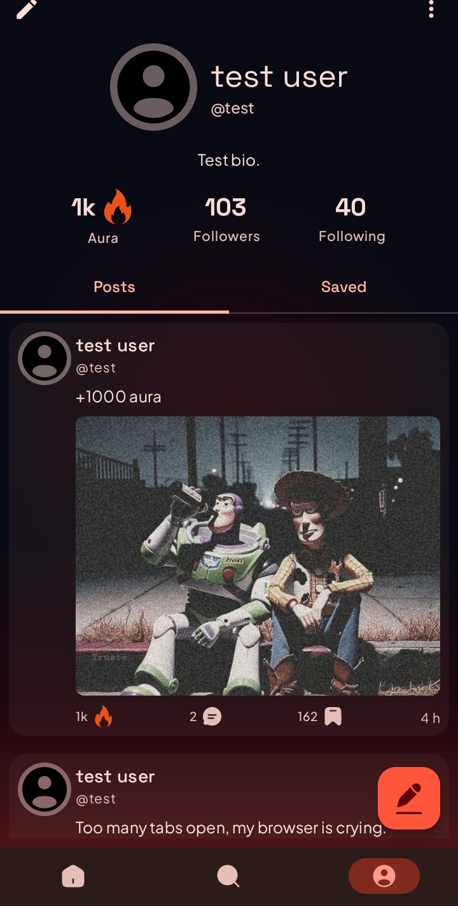
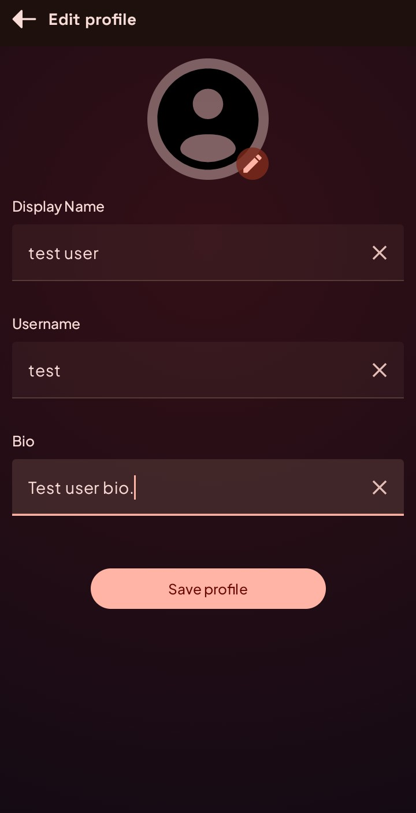
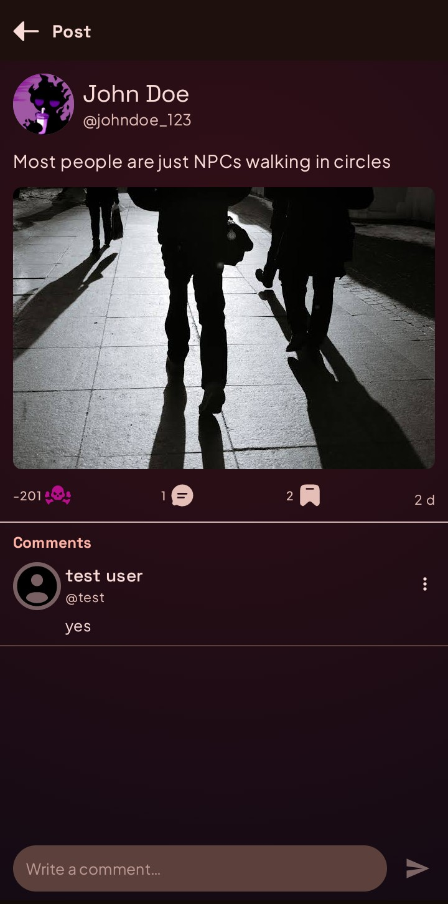
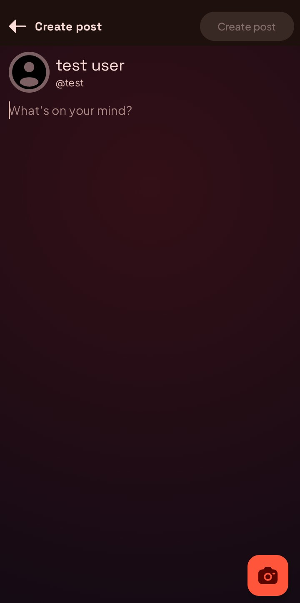

# 🔥 FlexAura

A social media application built for Android using Jetpack Compose, Clean Architecture, and MVI. Designed with an **Offline-First** philosophy, Flexaura delivers instant UI interactions via optimistic updates, smooth media handling, and robust synchronization between a local Room database and a remote Supabase backend.

---

## 🚀 Features

- 🔐 **Authentication & Credentials**: Secure sign-in and registration powered by Supabase Auth.
- 📰 **Paginated Feed (Home)**: Infinite scrolling home feed featuring posts, image attachments, aura voting, and saved bookmarks.
- ✍️ **Post Creation**: Create posts with image selection via system picker, uploaded directly to Supabase Storage.
- 💬 **Interactive Post Detail**: In-depth view for individual posts with threaded comments, real-time aura calculation, and post deletion.
- 🔍 **Global Search**: Search users and posts with tabbed results and paginated loading.
- 👤 **Profile & Customization**: Customizable user profile featuring bio, avatar upload, follower and following counts.
- ⚡ **Optimistic Updates & Offline First**: Local Room database acts as the Single Source of Truth. Vote, bookmark, and social interactions reflect instantly in the UI with automatic background sync and error reversal.

---

## 📸 Screens

### 🔑 Auth
| Login Screen | Register Screen |
|--------------|-----------------|
|  |  |

*Secure user entry flow with email/password authentication and input validation.*

---

### 🏠 Home
| Home Feed |
|-----------|
|  |

*Main dynamic feed featuring paginated posts, optimistic aura voting, local bookmarking, and instant background sync.*

---

### 🔍 Search
| Search Screen |
|---------------|
|  |

*Global search interface with tabbed results allowing quick discovery of both users and posts.*

---

### 👤 Profile
| Profile Screen | Edit Profile |
|----------------|--------------|
|  |  |

*Personal user hub showcasing aura stats, follower and following counts, user posts, and options to update avatar, bio, and display name.*

---

### 📝 Posts
| Post Detail | Create Post |
|-------------|-------------|
|  |  |

*Comprehensive post interaction view with comment section and a dedicated creation screen supporting image uploads.*

---

## 🧱 Tech Stack

- **UI & Design**: Jetpack Compose + Material 3 + Custom Design System
- **Architecture**: MVI (Model-View-Intent) + Clean Architecture + Multi-module
- **Local Persistence**: Room Database (Single Source of Truth)
- **Backend & Auth**: Supabase (PostgREST, Auth, Storage)
- **Dependency Injection**: Hilt + Hilt Navigation Compose
- **Reactive & Async**: Flow, StateFlow, SharedFlow
- **Testing**: JUnit 4, MockK

---

## 🏛 Architecture

Flexaura is structured as a highly scalable **multi-module** project following **Clean Architecture** and **MVI**:

```text
Flexaura
├── :app                   # App initialization, Navigation host
├── :core
│   ├── :designsystem      # Material3 theme, typography, color schemes, custom primitives
│   ├── :components        # Shared Compose components
│   ├── :database          # Room Entities, DAOs, Database configuration
│   └── :network           # Supabase client, Remote Data Sources
├── :data                  # Domain models, Repository implementations, Use Cases, Mappers, DI
└── :features
    ├── :auth              # Login & Registration screens
    ├── :home              # Main feed screen with optimistic voting & bookmarks
    ├── :createpost        # Post creation & image upload screen
    ├── :post              # Post detail view & comment section
    ├── :search            # User & post search screen
    └── :profile           # User profile & profile editing screens
```
## Unidirectional Data Flow (MVI)
- UI State: Exposed via StateFlow<UiState> for predictable, deterministic UI rendering.
- UI Intent: User actions emitted as sealed UiIntent interfaces processed by ViewModels.
- UI Effect: One-shot side-effects (snackbars, navigation) handled via SharedFlow<UiEffect>.

## 🛠️ Built With
- Kotlin 2.0.21
- Jetpack Compose (BOM 2024.09.00)
- Supabase Kotlin SDK 3.0.3
- Hilt 2.52
- Room 2.6.1
- Navigation Compose 2.8.3
- Coil 2.7.0
- Firebase BOM 33.5.1

---

Made by [Nicolás Cristaldo](https://github.com/nicolasCristaldo)
